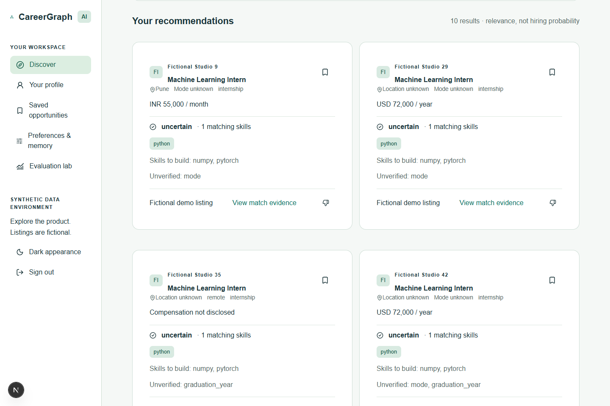

# CareerGraph AI

Built by [Hiten Arora](https://github.com/Hiten41).
An agentic, explainable job discovery and recommendation platform.

CareerGraph lets candidates review resume-derived skills, search fictional jobs, refine constraints over several turns and inspect the evidence behind each recommendation. An account owns its search history, confirmed preferences, saved jobs and feedback. All demonstration jobs are fictional and carry example.invalid provenance links.



## Run locally
From the extracted repository root, use PowerShell with Docker Compose installed.
```powershell
Copy-Item .env.example .env
docker compose up -d --build
docker compose exec api python scripts/seed.py
docker compose exec api python scripts/evaluate.py
```
Open http://localhost:3000 and create an account. To create a separate synthetic demo account, set DEMO_PASSWORD in .env to a locally chosen password of at least 12 characters before starting Compose. The seed creates demo@example.invalid using that password. No shared account is created by default. The first seed downloads all-MiniLM-L6-v2 into the persistent model volume. To stop the services while preserving data, run `docker compose down`.

Open http://localhost:8000/docs for the interactive REST API. The frontend proxies /api to the backend. For local development outside Compose, install Python 3.12+, the API requirements, Node 24, and PostgreSQL with pgvector. Set DATABASE_URL, set PYTHONPATH to apps/api, run Alembic with apps/api/alembic.ini, then start uvicorn app.main:app and npm run dev from apps/web.

## Repository
```text
apps/api/app/       routes, auth, SQL repositories, ingestion, retrieval, ranking, memory, agent and evaluation
apps/api/migrations/ versioned Alembic schema
apps/web/           Next.js App Router workspace, component tests and browser test
packages/contracts/ generated OpenAPI schema and TypeScript declarations
infra/              backend and frontend container builds
scripts/            import, seed, evaluate and capture query plans
tests/              rules, PDF extraction, account isolation and agent conversations
docs/               architecture, evaluations, deployment, demo and evidence
.github/workflows/  automated quality checks
```
## Verification
Install pytest, mypy and ruff in the API environment. Run `python -m pytest -q` and `mypy apps/api/app --check-untyped-defs`. Set CG_INTEGRATION=1 against an isolated migrated database and CG_SEEDED_TESTS=1 after adding the default seed. Keep the LLM disabled for deterministic regression tests. In apps/web run `npm ci`, `npm test`, `npm run lint`, `npm run typecheck`, and `npm run build`. Against the running seeded application run `npx playwright install chromium` and `npx playwright test`.

The local verification used a PostgreSQL-compatible PGlite runtime with pgvector, psycopg, Alembic, actual MiniLM embeddings, FastAPI and Edge. The Compose deployment itself still needs verification on a Docker host. No external deployment or hosted LLM calls were made.

See [engineering evidence](docs/REQUIREMENTS_TRACEABILITY.md), [measured evaluation](docs/EVALUATION.md), [limitations and deployment](docs/DEPLOYMENT.md) and [demo walkthrough](docs/DEMO_SCRIPT.md).

## Expanded inventory and ranking verification
For the original 40-job comparison run the seed and evaluation commands above **before** importing the expanded inventory. Then run:
```powershell
docker compose exec api python scripts/scale_seed.py
docker compose exec api python scripts/editorial_eval.py
```
The expanded seed adds 1,000 deterministic background records and 12 authored jobs. The second evaluation searches the entire index for the targets in 30 separately written judgments. The evaluation files are under scripts/fixtures. On the original fixture, bounding personal signals and incorporating semantic score magnitude restored personalized NDCG@10 from 0.642 to 1.000. On the 1,052-record index, hybrid and personalized each reached 0.987 for named-target NDCG@10. Individual preferences and hiring outcomes were not labeled.

The local HTTP benchmark completed 40 authenticated personalized searches with four concurrent clients, four warm queries and one embedded database connection. Median latency was 273 ms and p95 was 379 ms. See [retrieval traces](docs/editorial-results.json), [load measurements](docs/http-load.json) and [ingestion measurements](docs/ingestion-results.json).

Hosted routing requires an approved provider, LLM_MODEL, LLM_API_KEY and a checked provider-consent box. With a configured running local API, use `python scripts/hosted_smoke.py --allow-provider-call` to exercise real provider routing with a disposable synthetic account. This session exercised the HTTP protocol with a test transport. Actual hosted output quality remains unmeasured.

## Audit follow-up
After the expanded seed, run `docker compose exec api python scripts/graded_eval.py` and `docker compose exec api python scripts/agent_eval.py`. The graded split contains 100 queries in 25 related clusters. Personalized and hybrid named-target NDCG@10 were 0.876 and 0.875. Keyword-only NDCG@10 improved from 0.000 to 0.660 with a fallback for plain-language queries. Consult [evaluation methodology](docs/EVALUATION.md) before interpreting these metrics.

The application now persists revocable provider consent and requires opt-in for each hosted request. The resume parser recognizes skill aliases, extracts labeled experience, projects, education and graduation, attaches source lines and rejects textless PDFs. Auth and match evidence have separate UI components. Direct-search failures clear prior recommendation cards. The repository includes a local snapshot adapter with explicit authoritative expiry. Docker and actual hosted execution remain pending.
