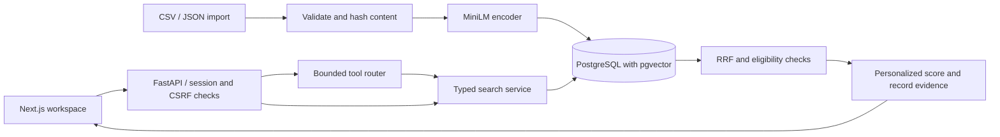

# Request and data flow

FastAPI shares a transaction across request dependencies. A conversation update locks the owner's session row while merging filters and appending messages. Shared ingestion and retrieval functions power both CLI and HTTP entry points. The evaluation runner calls the same search pipeline and persists measured runs.

The provider adapter in agents/provider.py validates the returned message and function envelope. The authenticated API loads bounded recent user messages and evaluates persisted consent before entering the provider branch. Only validated tool outputs supply presented job facts. The web app now has separate authentication and match-dialog components and clears old recommendation cards at the start of a new request.
